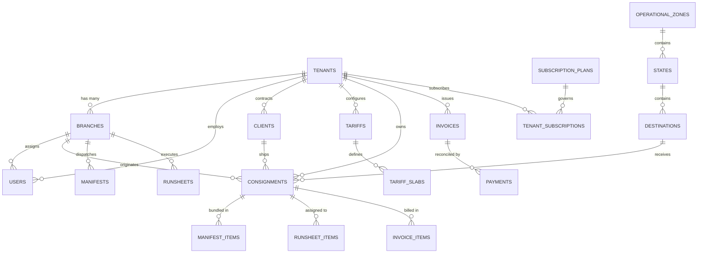

# Database Design & Data Modeling Specification
## Courier ERP Multi-Tenant SaaS Platform (MySQL 8 / Prisma ORM)

---

## 1. Entity-Relationship Overview

The database design provides robust multi-tenant data isolation, referential integrity, and high-performance querying for logistics operations across millions of shipments.

---

## 2. Relational Schema Specification

### 2.1 Multi-Tenant Core: `tenants` & `branches`

#### Table: `tenants` (Courier Agencies)
| Column Name | Data Type | Constraints | Description |
| :--- | :--- | :--- | :--- |
| `id` | INT | PK, AUTO_INCREMENT | Internal primary key |
| `uuid` | VARCHAR(64) | UNIQUE, NOT NULL | Public tenant identifier |
| `slug` | VARCHAR(64) | UNIQUE, NOT NULL | Agency subdomain/slug (e.g. `raipur`) |
| `agency_code` | VARCHAR(32) | UNIQUE, NULL | Platform-assigned agency code (e.g. `26`) |
| `name` | VARCHAR(150) | NOT NULL | Registered business name |
| `trade_name` | VARCHAR(150) | NULL | Display trade/brand name |
| `contact_person`| VARCHAR(100) | NOT NULL | Principal owner name |
| `phone` | VARCHAR(20) | NOT NULL | Primary contact phone |
| `email` | VARCHAR(120) | NOT NULL | Primary administrative email |
| `address` | TEXT | NULL | Registered office address |
| `city` | VARCHAR(100) | NULL | Operating city |
| `state` | VARCHAR(100) | NULL | Operating state (e.g. Chhattisgarh) |
| `pincode` | VARCHAR(10) | NULL | 6-digit PIN code |
| `gstin` | VARCHAR(20) | NULL | Indian GSTIN number (15 chars) |
| `pan_no` | VARCHAR(20) | NULL | Indian PAN number (10 chars) |
| `status` | ENUM | NOT NULL, DEFAULT 'pending_kyc' | `pending_otp`, `pending_kyc`, `active`, `suspended`, `expired`, `rejected` |
| `plan_id` | INT | NULL, FK -> subscription_plans | Current active subscription plan |
| `validity_start`| DATE | NULL | Subscription start date |
| `validity_end` | DATE | NULL | Subscription expiration date |
| `grace_period` | INT | DEFAULT 7 | Grace period in days before login suspension |
| `logo_url` | VARCHAR(255) | NULL | Brand logo path |
| `brand_color` | VARCHAR(20) | DEFAULT '#1a73e8' | Primary UI brand color |
| `created_at` | DATETIME | DEFAULT CURRENT_TIMESTAMP | Record creation timestamp |
| `updated_at` | DATETIME | ON UPDATE CURRENT_TIMESTAMP| Last modification timestamp |

#### Table: `branches`
| Column Name | Data Type | Constraints | Description |
| :--- | :--- | :--- | :--- |
| `id` | INT | PK, AUTO_INCREMENT | Internal primary key |
| `tenant_id` | INT | NOT NULL, FK -> tenants(id) | Parent agency reference |
| `branch_code`| VARCHAR(32) | NOT NULL | Branch identifier (e.g. `RAI-01`) |
| `branch_name`| VARCHAR(120) | NOT NULL | Name of branch (e.g. `Pandri Branch`) |
| `address` | TEXT | NOT NULL | Physical branch address |
| `city` | VARCHAR(100) | NOT NULL | Branch city |
| `state` | VARCHAR(100) | NOT NULL | Branch state |
| `pincode` | VARCHAR(10) | NOT NULL | 6-digit postal code |
| `phone` | VARCHAR(20) | NOT NULL | Branch desk phone |
| `manager_id` | INT | NULL, FK -> users(id) | Assigned Branch Manager |
| `status` | ENUM | DEFAULT 'active' | `active`, `inactive`, `closed` |
| `created_at` | DATETIME | DEFAULT CURRENT_TIMESTAMP | Creation timestamp |

---

### 2.2 Identity & Access: `users` & `refresh_tokens`

#### Table: `users`
| Column Name | Data Type | Constraints | Description |
| :--- | :--- | :--- | :--- |
| `id` | INT | PK, AUTO_INCREMENT | User ID |
| `tenant_id` | INT | NULL, FK -> tenants(id) | NULL for Super Admin; scoped for agency users |
| `branch_id` | INT | NULL, FK -> branches(id) | Scoped branch for branch managers/staff |
| `name` | VARCHAR(100) | NOT NULL | Full user name |
| `email` | VARCHAR(120) | UNIQUE, NOT NULL | Login email address |
| `phone` | VARCHAR(20) | NULL | Contact mobile number |
| `password_hash`| VARCHAR(255) | NOT NULL | Argon2id / bcrypt password hash |
| `role` | ENUM | NOT NULL | `superadmin`, `agency_admin`, `branch_manager`, `operations_staff`, `delivery_personnel`, `accounts_staff`, `customer` |
| `status` | ENUM | DEFAULT 'active' | `active`, `inactive`, `locked`, `suspended` |
| `failed_logins`| INT | DEFAULT 0 | Failed login attempt counter |
| `locked_until` | DATETIME | NULL | Timestamp until brute-force lock expires |
| `last_login_at`| DATETIME | NULL | Last successful authentication timestamp |
| `created_at` | DATETIME | DEFAULT CURRENT_TIMESTAMP | User registration timestamp |

#### Table: `refresh_tokens`
| Column Name | Data Type | Constraints | Description |
| :--- | :--- | :--- | :--- |
| `id` | INT | PK, AUTO_INCREMENT | Token ID |
| `user_id` | INT | NOT NULL, FK -> users(id) | User owner |
| `token_hash` | VARCHAR(255) | UNIQUE, NOT NULL | Hashed refresh token |
| `expires_at` | DATETIME | NOT NULL | Token expiry timestamp |
| `is_revoked` | BOOLEAN | DEFAULT FALSE | Revocation status |
| `created_at` | DATETIME | DEFAULT CURRENT_TIMESTAMP | Issuance timestamp |

---

### 2.3 SaaS Subscription Engine: `subscription_plans` & `tenant_subscriptions`

#### Table: `subscription_plans`
| Column Name | Data Type | Constraints | Description |
| :--- | :--- | :--- | :--- |
| `id` | INT | PK, AUTO_INCREMENT | Plan ID |
| `name` | VARCHAR(50) | NOT NULL | Plan title (e.g. `Professional Tier`) |
| `description`| TEXT | NULL | Feature highlights and description |
| `price` | DECIMAL(10,2)| NOT NULL | Subscription fee in INR |
| `billing_cycle`| ENUM | NOT NULL | `monthly`, `quarterly`, `half_yearly`, `yearly` |
| `duration_days`| INT | NOT NULL | Duration in days (30, 90, 180, 365) |
| `max_branches` | INT | DEFAULT 3 | Branch limit (-1 for unlimited) |
| `max_users` | INT | DEFAULT 10 | Staff user limit (-1 for unlimited) |
| `booking_quota`| INT | DEFAULT 5000 | Monthly consignment quota |
| `features_json`| JSON | NULL | Feature flags (e.g. API access, GSTR-1, Thermal) |
| `is_active` | BOOLEAN | DEFAULT TRUE | Plan availability toggle |
| `created_at` | DATETIME | DEFAULT CURRENT_TIMESTAMP | Creation timestamp |

---

### 2.4 Destination Master & Hierarchy

#### Table: `operational_zones`
- `id` INT PK, `code` VARCHAR(30) UNIQUE, `name` VARCHAR(100), `description` TEXT.

#### Table: `states`
- `id` INT PK, `code` VARCHAR(10) UNIQUE, `name` VARCHAR(100), `zone_id` INT FK, `gst_code` VARCHAR(10).

#### Table: `destinations`
- `id` INT PK, `code` VARCHAR(30) UNIQUE, `name` VARCHAR(120), `state_id` INT FK, `pincode` VARCHAR(10), `is_hub` BOOLEAN, `is_active` BOOLEAN.

---

### 2.5 Customers & Commercial Tariffs: `clients`, `tariffs`, `tariff_slabs`

#### Table: `clients` (Corporate B2B Accounts)
- `id` INT PK, `tenant_id` INT FK, `client_code` VARCHAR(30), `name` VARCHAR(150), `contact_person` VARCHAR(100), `phone` VARCHAR(20), `email` VARCHAR(120), `address` TEXT, `city` VARCHAR(100), `state` VARCHAR(100), `pincode` VARCHAR(10), `gstin` VARCHAR(20), `pan_no` VARCHAR(20), `fuel_surcharge_percent` DECIMAL(5,2) DEFAULT 10.0, `status` ENUM('active', 'inactive').

#### Table: `tariffs` & `tariff_slabs`
- Tariffs link `tenant_id`, optional `client_id`, `send_by` (Air/Surface), `mode` (Dox/Non-Dox), `zone_id`, `additional_weight_step`, `additional_weight_rate`.
- Tariff Slabs specify weight ranges (`weight_from`, `weight_to`, `rate`).

---

### 2.6 Core Shipments: `consignments`

#### Table: `consignments`
| Column Name | Data Type | Constraints | Description |
| :--- | :--- | :--- | :--- |
| `id` | INT | PK, AUTO_INCREMENT | Consignment ID |
| `tenant_id` | INT | NOT NULL, FK -> tenants(id) | Tenant owner |
| `branch_id` | INT | NOT NULL, FK -> branches(id)| Originating booking branch |
| `booking_date`| DATE | NOT NULL | Date of booking |
| `consignment_no`| VARCHAR(50) | UNIQUE, NOT NULL | 14-digit GS1 AWB Number |
| `client_id` | INT | NOT NULL, FK -> clients(id) | Consignor client account |
| `sender_name`| VARCHAR(100) | NOT NULL | Sender name |
| `sender_phone`| VARCHAR(20) | NOT NULL | Sender contact phone |
| `recipient_name`| VARCHAR(100)| NOT NULL | Consignee name |
| `recipient_phone`| VARCHAR(20)| NOT NULL | Consignee contact phone |
| `recipient_address`| TEXT | NOT NULL | Destination delivery address |
| `destination_id`| INT | NOT NULL, FK -> destinations(id)| Delivery hub destination |
| `mode` | ENUM('Dox','Non-Dox')| NOT NULL | Document or Cargo |
| `send_by` | ENUM('Air','Surface')| NOT NULL | Transit carrier mode |
| `pieces` | INT | DEFAULT 1 | Number of package pieces |
| `dead_weight` | DECIMAL(8,2) | NOT NULL | Actual dead weight in kg |
| `volumetric_weight`| DECIMAL(8,2)| NULL | Volumetric weight in kg (CFT formula) |
| `billable_weight`| DECIMAL(8,2)| NOT NULL | Maximum of dead vs volumetric weight |
| `subtotal` | DECIMAL(10,2)| NOT NULL | Freight rate before surcharges |
| `fuel_surcharge`| DECIMAL(10,2)| DEFAULT 0.00 | Fuel surcharge amount |
| `docket_charge`| DECIMAL(10,2)| DEFAULT 0.00 | Stationary docket charge |
| `other_charges`| DECIMAL(10,2)| DEFAULT 0.00 | Handling, insurance, or remote area charges |
| `total_amount`| DECIMAL(10,2)| NOT NULL | Final consignment charge |
| `status` | ENUM | DEFAULT 'booked' | `booked`, `in_manifest`, `in_transit`, `out_for_delivery`, `delivered`, `delivery_attempted`, `cancelled` |
| `is_billed` | BOOLEAN | DEFAULT FALSE | B2B invoice billing indicator |
| `created_by` | INT | FK -> users(id) | Booking operator ID |
| `created_at` | DATETIME | DEFAULT CURRENT_TIMESTAMP | Booking timestamp |

---

### 2.7 Operations & Field Execution: `manifests` & `runsheets`

#### Table: `manifests` (Hub Dispatches)
- `id` INT PK, `tenant_id` INT FK, `branch_id` INT FK, `manifest_no` VARCHAR(50) UNIQUE, `destination_hub_id` INT FK, `driver_name` VARCHAR(100), `vehicle_no` VARCHAR(50), `total_consignments` INT, `total_weight` DECIMAL(10,2), `status` ENUM('dispatched', 'received'), `created_at` DATETIME.

#### Table: `runsheets` & `runsheet_items` (Delivery Runsheets & POD)
- `runsheets`: `id` INT PK, `tenant_id` INT FK, `branch_id` INT FK, `runsheet_no` VARCHAR(50) UNIQUE, `delivery_person_id` INT FK -> users(id), `delivery_date` DATE, `status` ENUM('assigned', 'in_progress', 'completed').
- `runsheet_items`: `id` INT PK, `runsheet_id` INT FK, `consignment_id` INT FK, `status` ENUM('pending', 'delivered', 'attempted', 'returned'), `attempt_count` INT DEFAULT 0, `failure_reason` VARCHAR(150), `recipient_name` VARCHAR(100), `recipient_relation` VARCHAR(50), `signature_url` TEXT, `photo_url` TEXT, `delivered_at` DATETIME.

---

### 2.8 Statutory Accounting: `invoices`, `invoice_items`, `payments`

#### Table: `invoices` (GST SAC 996812)
- `id` INT PK, `tenant_id` INT FK, `invoice_no` VARCHAR(50) UNIQUE, `invoice_date` DATE, `due_date` DATE, `client_id` INT FK, `period_from` DATE, `period_to` DATE, `consignments_count` INT, `subtotal_amount` DECIMAL(10,2), `fuel_surcharge_amount` DECIMAL(10,2), `docket_charge_amount` DECIMAL(10,2), `taxable_amount` DECIMAL(10,2), `cgst_rate` DECIMAL(5,2), `cgst_amount` DECIMAL(10,2), `sgst_rate` DECIMAL(5,2), `sgst_amount` DECIMAL(10,2), `igst_rate` DECIMAL(5,2), `igst_amount` DECIMAL(10,2), `total_gst_amount` DECIMAL(10,2), `round_off` DECIMAL(5,2), `grand_total` DECIMAL(10,2), `payment_status` ENUM('pending', 'partially_paid', 'paid', 'cancelled'), `paid_amount` DECIMAL(10,2) DEFAULT 0.00.

#### Table: `payments`
- `id` INT PK, `tenant_id` INT FK, `invoice_id` INT FK, `receipt_no` VARCHAR(50) UNIQUE, `amount` DECIMAL(10,2), `payment_date` DATE, `payment_mode` ENUM('cash', 'cheque', 'neft_rtgs', 'upi'), `reference_no` VARCHAR(100), `notes` TEXT.

---

## 3. Query Optimization & Indexing Strategy

To guarantee sub-second performance across high transaction volumes:
1. `consignments(consignment_no)`: Unique B-Tree Index for instant barcode scan lookups.
2. `consignments(tenant_id, booking_date)`: Composite Index for dashboard metrics and date range filtering.
3. `consignments(tenant_id, client_id, is_billed)`: Composite Index for rapid unbilled consignment aggregation during monthly invoice generation.
4. `invoices(tenant_id, invoice_no)`: Unique Composite Index for accounting lookups.
5. `runsheet_items(consignment_id)`: Foreign key index for delivery status updates.
